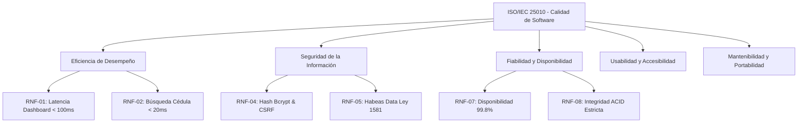

# ESPECIFICACIÓN DE REQUERIMIENTOS DE SOFTWARE (SRS)
## Sistema de Gestión y Analítica — Puntos Vive Digital (PVD)
### Alcaldía Municipal de Acacías — Meta | Secretaría de las TIC

---

| Metadato del Documento | Detalle Institucional |
|---|---|
| **Proyecto:** | Plataforma de Registro, Gestión Comunitaria y Analítica PVD |
| **Entidad Propietaria:** | Alcaldía de Acacías — Nit: 892.099.169-4 |
| **Dependencia:** | Oficina de Tecnologías de la Información y las Comunicaciones (TIC) |
| **Versión del Documento:** | 2.0.0 (Producción / Entrega Final) |
| **Estándar Aplicado:** | IEEE Std 830-1998 / ISO/IEC/IEEE 29148:2018 |
| **Clasificación:** | Documento Oficial de Ingeniería — Reservado Institucional |
| **Fecha de Publicación:** | Septiembre de 2026 |

---

## 1. INTRODUCCIÓN Y ALCANCE

### 1.1 Propósito
El presente documento define formalmente la Especificación de Requerimientos de Software (SRS) para la nueva plataforma digital de los Puntos Vive Digital (PVD) de la Alcaldía de Acacías. Establece las funciones, restricciones operacionales, lineamientos de rendimiento y seguridad exigidos para la operación del sistema en el Servidor Privado Virtual (VPS) de la entidad territorial.

### 1.2 Alcance del Sistema
La plataforma administra el ciclo completo de atención a la ciudadanía en la red de Puntos Vive Digital de Acacías:
* **Padrón Único de Ciudadanos:** Maestro centralizado de beneficiarios con trazabilidad sociodemográfica (23.800+ ciudadanos registrados).
* **Gestión de Visitas y Trámites:** Registro de atenciones diarias en sedes físicas, con enlace atómico de ciudadanos y clasificación de servicios.
* **Préstamos de Salas y Espacios Comunitarios:** Reservas para capacitación comunitaria, instituciones educativas, juntas comunales, ICBF y eventos formativos (2.100+ préstamos reclasificados).
* **Control de Consumo de Impresiones:** Monitoreo del uso de suministros y folios impresos por ciudadano y sede.
* **Motor Analítico y Predictivo:** Métricas en tiempo real, predicción de aforo de atención y sugerencia inteligente de trámites.
* **Exportación y Reportería Oficial:** Generador parametrizado de reportes en formatos Excel (.xlsx) y CSV para analítica institucional y rendición de cuentas.

### 1.3 Perfiles de Usuario (Actores)

| Actor | Descripción y Nivel de Responsabilidad |
|---|---|
| **Administrador General (TIC)** | Funcionario directivo de la Secretaría TIC. Acceso irrestricto al sistema, auditoría forense, gestión de usuarios/sedes y reportes globales. |
| **Coordinador de Sede PVD** | Responsable de un Punto Vive Digital físico. Monitorea afluencia, gestiona reservas de salas, atiende visitas y genera reportes de su punto. |
| **Gestor de Punto** | Operador de ventanilla en sala. Registra la llegada de ciudadanos, valida documentos de identidad, registra trámites e impresiones. |
| **Auditor / Ente de Control** | Rol consultivo para verificación de cumplimiento de metas del Plan de Desarrollo Municipal y ley de transparencia. |

---

## 2. REQUERIMIENTOS FUNCIONALES (RF)

Los requerimientos funcionales especifican las capacidades que el sistema debe ejecutar de manera determinista:

| Código | Módulo | Nombre del Requerimiento | Prioridad |
|:---:|:---:|---|:---:|
| **RF-01** | Seguridad | Autenticación Segura y Control de Sesión | **Alta** |
| **RF-02** | Ciudadanos | Búsqueda Predictiva Multicriterio de Ciudadanos | **Alta** |
| **RF-03** | Ciudadanos | Cálculo Dinámico y Persistencia de Edad | **Alta** |
| **RF-04** | Ciudadanos | Edición 100% Completa de Variables Sociodemográficas | **Alta** |
| **RF-05** | Visitas | Registro Atómico de Visita con Auto-Creación de Ciudadano | **Alta** |
| **RF-06** | Visitas | Asociación de Categoría y Trámite Normalizado | **Alta** |
| **RF-07** | Salas | Gestión y Reclasificación de Préstamos Comunitarios | **Alta** |
| **RF-08** | Impresiones | Registro y Control de Consumo de Hojas | **Media** |
| **RF-09** | Reportes | Exportación Paramétrica a Excel (.xlsx) con Estilo | **Alta** |
| **RF-10** | Reportes | Exportación de Datos en Formato CSV UTF-8 para Big Data | **Media** |
| **RF-11** | Analítica | Cálculo de KPIs en Tiempo Real para el Dashboard | **Alta** |
| **RF-12** | IA / ML | Motor Predictivo de Aforo y Próximos Servicios | **Media** |
| **RF-13** | Personalización | Gestión de Campos Dinámicos Adicionales | **Media** |
| **RF-14** | Auditoría | Registro Inmutable de Trazabilidad y Logs Forenses | **Alta** |
| **RF-15** | PVD | Administración de Sedes Activas y Preservación Histórica | **Alta** |

---

### Especificación Detallada de Requerimientos Críticos

#### RF-01: Autenticación Segura y Control de Sesión
* **Descripción:** El sistema debe autenticar a los funcionarios mediante correo institucional y contraseña encriptada.
* **Entradas:** Correo electrónico (`email`), Contraseña en texto plano (`password`).
* **Proceso:** Validación del hash mediante algoritmo Bcrypt (cost factor 12). Regeneración del identificador de sesión para prevenir Session Fixation. Protección contra fuerza bruta (máximo 5 intentos fallidos por minuto por IP).
* **Salidas:** Token de sesión autenticado, redirección al Dashboard según el rol del funcionario.

#### RF-03: Cálculo Dinámico y Persistencia de Edad
* **Descripción:** Al ingresar o modificar la fecha de nacimiento de un ciudadano (`fecha_nacimiento`), el sistema debe calcular de manera automática y exacta su edad en años cumplidos en tiempo real.
* **Fórmula:** $\text{Edad} = \lfloor \text{Diferencia en años entre } \text{fecha\_nacimiento} \text{ y } \text{fecha\_actual} \rfloor$.
* **Criterio de Aceptación:** Si la fecha cambia en el formulario mediante JavaScript o backend, el campo `edad` se actualiza inmediatamente tanto en la interfaz como en la base de datos.

#### RF-04: Edición 100% Completa de Variables Sociodemográficas
* **Descripción:** Los funcionarios deben poder actualizar la totalidad de los campos sociodemográficos de cualquier ciudadano previamente registrado en el padrón municipal.
* **Campos Editables:** `nivel_educativo` (Primaria, Secundaria, Técnico, Tecnólogo, Universitario, Posgrado/Maestría), `barrio`, `zona` (Urbana / Rural), `estrato` (1 al 6), `telefono`, `correo`, `direccion`, `ocupacion`, `grupo_etnico`, `g_poblacional`, `t_aseguramiento`.
* **Criterio de Aceptación:** Ningún campo puede quedar bloqueado o en modo solo-lectura una vez creado el ciudadano. Cualquier edición genera un registro en la tabla de auditoría con los valores anteriores y los nuevos.

#### RF-05: Registro Atómico de Visita con Auto-Creación de Ciudadano
* **Descripción:** Al momento de registrar una visita en ventanilla, si el número de documento no existe en la base de datos, el sistema debe crear al ciudadano y registrar la visita de manera simultánea en una única transacción ACID.
* **Garantía ACID:** Si falla cualquier campo de la visita o del ciudadano, se ejecuta un `DB::rollBack()` automático, impidiendo la existencia de registros huérfanos o inconsistencias referenciales.

#### RF-07: Gestión y Reclasificación de Préstamos Comunitarios
* **Descripción:** El sistema debe gestionar las reservas de los espacios de cómputo y aulas digitales asignando cada préstamo a una categoría comunitaria real:
  1. Convenios Formativos y Cursos SENA / Alcaldía
  2. Instituciones Educativas y Colegios
  3. ICBF y Programas de Niñez / Primera Infancia
  4. Juntas de Acción Comunal (JAC) y Asambleas Barriales
  5. Cine Comunitario, Cineclub y Proyecciones Audiovisuales
  6. Programas Sociales, Paz y Fundaciones Comunitarias
  7. Expresiones Culturales, Arte, Deporte y Danza
  8. Jornadas de Salud, Vacunación y Brigadas
  9. Emprendimiento, Comercio Local y Empleo
  10. Reuniones y Eventos Institucionales de la Alcaldía
  11. Otras Actividades Comunitarias

---

## 3. REQUERIMIENTOS NO FUNCIONALES (RNF) — ISO/IEC 25010

Los requerimientos no funcionales definen los criterios de calidad, rendimiento y robustez técnica:

### 3.1 Eficiencia de Desempeño (Performance)
* **RNF-01 (Latencia del Dashboard):** El cálculo integral de las métricas del panel principal (total de visitas del día, acumulado del mes, gráfico de 7 días, distribución por categorías y sedes) no debe superar los **100 ms** bajo una carga de más de 150.000 registros en base de datos.
* **RNF-02 (Búsqueda Predictiva de Ciudadanos):** La búsqueda compuesta de ciudadanos por número de documento o nombre debe responder en menos de **25 ms** en el 95% de las peticiones (P95).
* **RNF-03 (Capacidad de Inserción Masiva):** El motor transaccional debe soportar una tasa de inserción superior a **1.000 transacciones por segundo** sin bloqueos de tabla (*database lock*).

### 3.2 Seguridad y Protección de la Información
* **RNF-04 (Cifrado de Credenciales):** Las contraseñas de los funcionarios se almacenan con algoritmo Bcrypt (función hash unidireccional con sal aleatoria de 16 bytes). En ningún caso se persiste texto plano.
* **RNF-05 (Cumplimiento Habeas Data - Ley 1581 de 2012):** La plataforma implementa anonimización de datos sensibles y control estricto de acceso basado en roles (RBAC). Se prohíbe la exposición de datos personales sin autenticación previa.
* **RNF-06 (Defensa en Profundidad):**
  * **Inyección SQL:** Mitigada al 100% mediante el uso exclusivo de sentencias parametrizadas (PDO Prepared Statements / ORM Eloquent).
  * **Cross-Site Scripting (XSS):** Mitigado nativamente mediante el motor de renderizado de React 18 (JSX auto-escaping) y sanitización estricta en el backend de Laravel.
  * **Falsificación de Petición en Sitios Cruzados (CSRF):** Cada formulario genera y valida un token criptográfico anti-CSRF por sesión.

### 3.3 Fiabilidad e Integridad Transaccional
* **RNF-07 (Disponibilidad Operativa):** Disponibilidad mínima del servicio del **99.8%** en horario laboral municipal (Lunes a Viernes de 7:00 a.m. a 6:00 p.m. y Sábados de 8:00 a.m. a 1:00 p.m.).
* **RNF-08 (Integridad ACID y Cero Huérfanos):** Toda operación que involucre más de una tabla debe encapsularse en una transacción de base de datos. En caso de corte eléctrico o falla del servidor, el motor debe aplicar `ROLLBACK` automático.

### 3.4 Usabilidad y Accesibilidad
* **RNF-09 (Diseño Adaptativo / Responsive):** La interfaz gráfica debe adaptarse dinámicamente a pantallas de escritorio (1920x1080, 1366x768), computadores portátiles y tabletas (mínimo 768px de ancho).
* **RNF-10 (Paleta Institucional Oficial):** El diseño visual incorpora los colores corporativos oficiales de la Alcaldía de Acacías (Verde Institucional `#1B6B35`, Oro de los Llanos `#D97706`, Fondo Neutro `#F8FAFC`).

### 3.5 Mantenibilidad y Portabilidad
* **RNF-11 (Arquitectura Modular Desacoplada):** El código fuente sigue la arquitectura limpia de capas: Separación estricta entre Modelos, Servicios de Negocio (`App\Services`), Controladores HTTP y Componentes React con TypeScript gestionados mediante Inertia.js.
* **RNF-12 (Independencia de Motor de Base de Datos):** La capa de acceso a datos utiliza abstracción completa de Laravel DB/Eloquent, permitiendo operar tanto sobre SQLite optimizado con WAL como migrar a PostgreSQL o MySQL sin alterar la lógica de negocio.

---

## 4. REGLAS DE NEGOCIO (RN)

1. **RN-01 (Unicidad de Documento de Identidad):** No pueden coexistir dos ciudadanos con el mismo número y tipo de documento.
2. **RN-02 (Filtro de Sedes Activas):** Los formularios de registro solo permiten seleccionar las **4 sedes físicas activas** (PLUS, Tradicional, Dinamarca, Chichimene). Las 2 sedes históricas se mantienen exclusivamente para consultas y reportes retroactivos.
3. **RN-03 (Restricción de Aforo de Salas):** Ninguna reserva de sala puede superar la capacidad máxima física del aula solicitada.
4. **RN-04 (Impresiones Gratuitas Comunitarias):** El sistema alerta al gestor si un ciudadano supera la cuota comunitaria mensual configurada (ej. 20 folios/mes).
5. **RN-05 (Inmutabilidad de Auditoría):** Los registros de la tabla `auditoria_logs` son de solo inserción (*append-only*); ningún usuario o gestor tiene permiso para editar o eliminar registros de auditoría.
