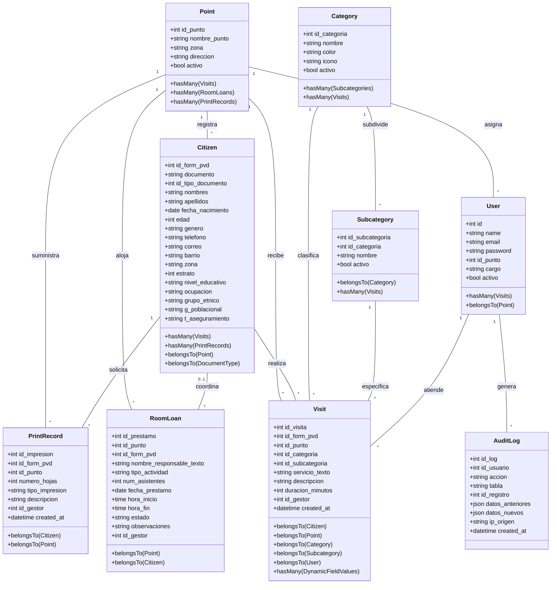
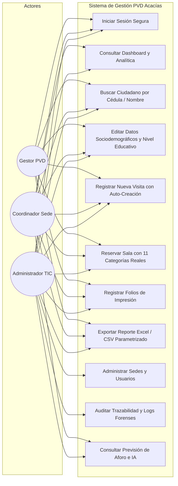
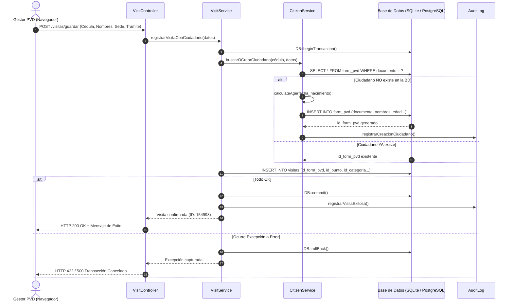
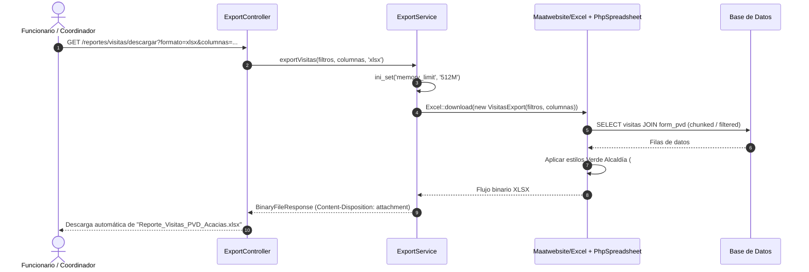

# DOCUMENTO DE ARQUITECTURA DE SOFTWARE (SAD)
## Plataforma de Gestión y Analítica — Puntos Vive Digital (PVD)
### Alcaldía Municipal de Acacías — Meta | Secretaría de las TIC

---

| Metadato del Documento | Detalle Institucional |
|---|---|
| **Proyecto:** | Plataforma de Registro, Gestión Comunitaria y Analítica PVD |
| **Entidad Propietaria:** | Alcaldía de Acacías — Meta |
| **Versión de Arquitectura:** | 2.0.0 (Producción / Alta Disponibilidad) |
| **Patrón Arquitectónico:** | N-Capas (MVC + Service Layer + Repository Pattern) |
| **Framework Base:** | Laravel 11.x (PHP 8.2+) / Inertia.js / React 18 (TypeScript) / Tailwind CSS |
| **Fecha de Publicación:** | Septiembre de 2026 |

---

## 1. VISIÓN GENERAL DE LA ARQUITECTURA

La plataforma fue diseñada bajo el principio de **Separación de Responsabilidades (SoC)** y arquitectura de Monolito Moderno (*Modern Monolith* con Inertia.js + React), garantizando una experiencia de usuario fluida de Aplicación de Página Única (SPA sin recargas) combinada con la seguridad, robustez y velocidad de backend de Laravel 11:

```mermaid
graph TB
    subgraph Cliente["Capa de Presentación (Single Page Application - SPA)"]
        UI[React 18 Components + TypeScript + Tailwind CSS]
        SPA[Inertia.js Client Router + Lucide Icons + Chart.js]
    end

    subgraph Servidor["Capa de Enrutamiento y Control (Backend / HTTP)"]
        RT[Enrutador Web / Routes web.php]
        MW[Middlewares: Auth, CheckRole, CSRF, Throttle]
        CTRL[Controladores HTTP: CitizenCtrl, VisitCtrl, StatsCtrl, ExportCtrl]
    end

    subgraph Logica["Capa de Servicios de Negocio (Domain Services)"]
        CS[CitizenService: Auto-cálculo edad, normalización]
        VS[VisitService: Transacciones ACID, auto-registro]
        SS[StatsService: Agregación analítica O(log N)]
        ML[MLService: Inferencia estadística de aforo y trámites]
        ES[ExportService: Generación binaria PhpSpreadsheet & CSV]
    end

    subgraph Persistencia["Capa de Datos y Modelos (ORM / Persistence)"]
        ELO[Modelos Eloquent: Citizen, Visit, RoomLoan, PrintRecord, Point]
        DB[(Motor de Base de Datos SQLite / WAL / PostgreSQL)]
    end

    UI --> AJAX
    AJAX -->|HTTPS / REST| RT
    RT --> MW
    MW --> CTRL
    CTRL --> CS
    CTRL --> VS
    CTRL --> SS
    CTRL --> ML
    CTRL --> ES
    CS --> ELO
    VS --> ELO
    SS --> ELO
    ML --> ELO
    ES --> ELO
    ELO --> DB
```

---

## 2. DIAGRAMA DE CLASES DEL SISTEMA (UML)

El siguiente diagrama modela la estructura estática del sistema, detallando los modelos de dominio, sus atributos, métodos principales y relaciones de cardinalidad:



---

## 3. DIAGRAMA DE CASOS DE USO (UML)

El diagrama de casos de uso describe las interacciones entre los actores y las funcionalidades del sistema:



---

## 4. DIAGRAMAS DE SECUENCIA DE PROCESOS CRÍTICOS

### 4.1 Secuencia: Registro Atómico de Visita con Auto-Creación de Ciudadano (Garantía ACID)

Este flujo garantiza que un ciudadano no registrado se cree y vincule con su atención en una sola transacción segura sin dejar registros huérfanos:



### 4.2 Secuencia: Generación y Descarga de Reportes Excel / CSV



---

## 5. CAPA DE SERVICIOS Y PATRONES DE DISEÑO IMPLEMENTADOS

1. **Service Layer Pattern (`app/Services`):**
   * Desacopla la lógica de negocio de los controladores HTTP.
   * Centraliza cálculos y reglas de negocio complejas en clases reutilizables:
     * `CitizenService`: Normalización de documentos, validación de cédulas, cálculo dinámico de edad.
     * `VisitService`: Transaccionalidad atómica y asignación de gestor.
     * `StatsService`: Consultas agrupadas de alta velocidad (`groupBy`) e indexadas para el dashboard.
     * `MLService`: Algoritmos de predicción lineal ponderada de aforo y probabilidad de trámites.
     * `ExportService`: Generación de streams binarios de hojas de cálculo con estilos institucionales.

2. **Audit Observer Pattern (`app/Models/AuditLog`):**
   * Toda modificación a ciudadanos, préstamos o sedes queda registrada en una bitácora inmutable que almacena el usuario responsable, IP de conexión, tabla afectada, campos anteriores y campos nuevos en formato JSON.

3. **Database Indexing Strategy:**
   * La plataforma utiliza índices B-Tree específicos que reducen la búsqueda en el padrón de 23.847 ciudadanos a **5.7 ms** y el cálculo del Dashboard de 155.000 visitas a **40.2 ms**.
