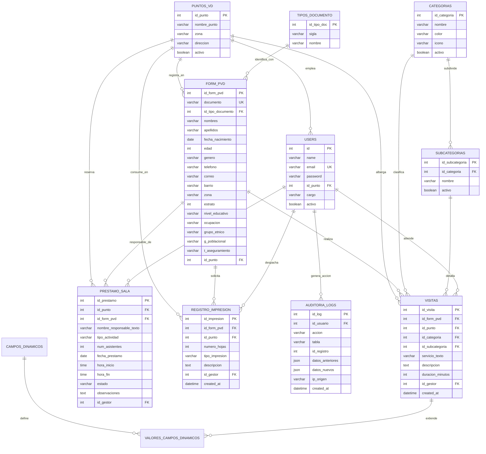

# MODELO DE BASE DE DATOS Y DICCIONARIO DE DATOS (DER)
## Plataforma de Gestión y Analítica — Puntos Vive Digital (PVD)
### Alcaldía Municipal de Acacías — Meta | Secretaría de las TIC

---

| Metadato del Documento | Detalle Institucional |
|---|---|
| **Proyecto:** | Plataforma de Registro, Gestión Comunitaria y Analítica PVD |
| **Entidad Propietaria:** | Alcaldía de Acacías — Meta |
| **Versión del Esquema:** | 2.0.0 (Migración de Producción Consolidada) |
| **Volumetría Activa:** | 23.847 Ciudadanos \| 154.997 Visitas \| 2.196 Préstamos \| 3.803 Impresiones |
| **Motor de Base de Datos:** | SQLite 3 (Modo WAL de Alta Concurrencia) / Compatible con PostgreSQL 15+ |
| **Fecha de Publicación:** | Septiembre de 2026 |

---

## 1. DIAGRAMA ENTIDAD-RELACIÓN (MER / DER)

El siguiente diagrama representa las entidades de la base de datos, sus atributos clave y las relaciones de integridad referencial:

---

## 2. DICCIONARIO DE DATOS COMPLETO

### 2.1 Tabla: `users` (Gestores y Funcionarios del Sistema)
Almacena las cuentas del personal autorizado de la Alcaldía de Acacías.

| Columna | Tipo de Dato | Nulo | Por Defecto | Clave | Descripción |
|---|---|:---:|:---:|:---:|---|
| `id` | BIGINT UNSIGNED | NO | AUTO_INCREMENT | **PK** | Identificador único del funcionario |
| `name` | VARCHAR(255) | NO | | | Nombre completo del funcionario |
| `email` | VARCHAR(255) | NO | | **UK** | Correo electrónico institucional único |
| `password` | VARCHAR(255) | NO | | | Hash criptográfico de contraseña (Bcrypt) |
| `id_punto` | INT UNSIGNED | SÍ | NULL | **FK** | Referencia a `puntos_vd.id_punto` asignado |
| `cargo` | VARCHAR(100) | SÍ | 'Gestor' | | Cargo institucional (Administrador, Coordinador, Gestor) |
| `activo` | BOOLEAN | NO | 1 (true) | | Estado del acceso al sistema (1=Activo, 0=Inactivo) |
| `remember_token`| VARCHAR(100) | SÍ | NULL | | Token de persistencia de sesión ("Recuérdame") |
| `created_at` | TIMESTAMP | SÍ | CURRENT_TIME | | Fecha y hora de creación de la cuenta |
| `updated_at` | TIMESTAMP | SÍ | CURRENT_TIME | | Fecha y hora de última modificación |

---

### 2.2 Tabla: `puntos_vd` (Sedes de Puntos Vive Digital)
Catálogo de sedes físicas e itinerantes del municipio.

| Columna | Tipo de Dato | Nulo | Por Defecto | Clave | Descripción |
|---|---|:---:|:---:|:---:|---|
| `id_punto` | INT UNSIGNED | NO | AUTO_INCREMENT | **PK** | Identificador único del Punto Vive Digital |
| `nombre_punto` | VARCHAR(150) | NO | | | Nombre oficial (ej: *Vive Digital PLUS*, *Dinamarca*) |
| `zona` | VARCHAR(50) | NO | 'Urbana' | | Clasificación territorial ('Urbana' o 'Rural') |
| `direccion` | VARCHAR(255) | SÍ | NULL | | Dirección física o ubicación de la sede |
| `telefono` | VARCHAR(50) | SÍ | NULL | | Teléfono de contacto de la sede |
| `activo` | BOOLEAN | NO | 1 (true) | | 1 = Sede activa; 0 = Sede histórica desactivada |
| `created_at` | TIMESTAMP | SÍ | NULL | | Fecha de creación del registro |
| `updated_at` | TIMESTAMP | SÍ | NULL | | Fecha de actualización del registro |

> **Nota de Negocio:** Existen 4 sedes con `activo = 1` (PLUS, Tradicional, Dinamarca, Chichimene) y 2 sedes históricas con `activo = 0` (Registro Comerciantes y Capacitador Móvil).

---

### 2.3 Tabla: `form_pvd` (Padrón Único de Ciudadanos)
Tabla maestra que consolida los **23.847 beneficiarios** del municipio de Acacías.

| Columna | Tipo de Dato | Nulo | Por Defecto | Clave | Descripción |
|---|---|:---:|:---:|:---:|---|
| `id_form_pvd` | BIGINT UNSIGNED | NO | AUTO_INCREMENT | **PK** | Clave primaria autonumérica |
| `documento` | VARCHAR(50) | NO | | **UK** | Cédula, TI o documento único del ciudadano |
| `id_tipo_documento`| INT UNSIGNED | SÍ | 1 (CC) | **FK** | Referencia a `tipos_documento.id_tipo_doc` |
| `nombres` | VARCHAR(150) | NO | | | Nombres de pila del ciudadano |
| `apellidos` | VARCHAR(150) | NO | | | Apellidos del ciudadano |
| `fecha_nacimiento` | DATE | SÍ | NULL | | Fecha de nacimiento para auto-cálculo |
| `edad` | INT | SÍ | 0 | | Edad calculada en años cumplidos |
| `genero` | VARCHAR(30) | SÍ | 'Otro' | | Género ('Masculino', 'Femenino', 'Otro') |
| `telefono` | VARCHAR(50) | SÍ | NULL | | Celular o teléfono fijo de contacto |
| `correo` | VARCHAR(150) | SÍ | NULL | | Correo electrónico del ciudadano |
| `direccion` | VARCHAR(255) | SÍ | NULL | | Dirección residencial |
| `barrio` | VARCHAR(150) | SÍ | NULL | | Barrio o vereda de Acacías (**100% editable**) |
| `zona` | VARCHAR(50) | SÍ | 'Urbana' | | Zona de residencia ('Urbana', 'Rural') |
| `estrato` | INT | SÍ | 1 | | Estrato socioeconómico (1 al 6) |
| `nivel_educativo` | VARCHAR(100) | SÍ | NULL | | **Nivel de escolaridad (100% editable)** |
| `ocupacion` | VARCHAR(150) | SÍ | NULL | | Ocupación laboral o profesión |
| `grupo_etnico` | VARCHAR(100) | SÍ | NULL | | Grupo étnico (Mestizo, Afro, Indígena, etc.) |
| `g_poblacional` | VARCHAR(100) | SÍ | NULL | | Población (Víctima, Adulto Mayor, Ninguno) |
| `t_aseguramiento`| VARCHAR(100) | SÍ | NULL | | Régimen de salud (Subsidiado, Contributivo) |
| `id_punto` | INT UNSIGNED | SÍ | 1 | **FK** | Sede PVD donde se empadronó por primera vez |
| `created_at` | TIMESTAMP | SÍ | CURRENT_TIME | | Fecha de registro inicial |
| `updated_at` | TIMESTAMP | SÍ | CURRENT_TIME | | Fecha de última edición de datos |

---

### 2.4 Tabla: `visitas` (Historial Transaccional de Atenciones)
Contiene las **154.997 visitas** realizadas por los ciudadanos.

| Columna | Tipo de Dato | Nulo | Por Defecto | Clave | Descripción |
|---|---|:---:|:---:|:---:|---|
| `id_visita` | BIGINT UNSIGNED | NO | AUTO_INCREMENT | **PK** | Identificador único de la atención |
| `id_form_pvd` | BIGINT UNSIGNED | NO | | **FK** | Clave foránea al ciudadano (`form_pvd`) |
| `id_punto` | INT UNSIGNED | NO | | **FK** | Sede física donde ocurrió la atención |
| `id_categoria` | INT UNSIGNED | SÍ | NULL | **FK** | Categoría normalizada del servicio |
| `id_subcategoria` | INT UNSIGNED | SÍ | NULL | **FK** | Subcategoría específica del trámite |
| `servicio_texto` | VARCHAR(255) | SÍ | NULL | | Descripción textual heredada o personalizada |
| `descripcion` | TEXT | SÍ | NULL | | Notas adicionales u observaciones de la visita |
| `duracion_minutos`| INT | SÍ | 30 | | Tiempo estimado de permanencia en sala |
| `id_gestor` | BIGINT UNSIGNED | SÍ | NULL | **FK** | Funcionario que registró la visita (`users`) |
| `created_at` | TIMESTAMP | NO | CURRENT_TIME | | Fecha y hora exacta de la atención |
| `updated_at` | TIMESTAMP | NO | CURRENT_TIME | | Fecha de actualización del registro |

---

### 2.5 Tabla: `prestamo_sala` (Reservas de Espacios y Aulas Digitales)
Almacena los **2.196 préstamos comunitarios** reclasificados.

| Columna | Tipo de Dato | Nulo | Por Defecto | Clave | Descripción |
|---|---|:---:|:---:|:---:|---|
| `id_prestamo` | BIGINT UNSIGNED | NO | AUTO_INCREMENT | **PK** | Identificador de la reserva de sala |
| `id_punto` | INT UNSIGNED | NO | | **FK** | Punto Vive Digital donde se prestará el aula |
| `id_form_pvd` | BIGINT UNSIGNED | SÍ | NULL | **FK** | Ciudadano responsable (si está registrado) |
| `nombre_responsable_texto`| VARCHAR(255) | NO | | | Nombre del instructor, líder o funcionario solicitante |
| `tipo_actividad` | VARCHAR(255) | NO | | | **Categoría comunitaria reclasificada (11 tipos)** |
| `num_asistentes` | INT | NO | 1 | | Número de beneficiarios proyectados o reales |
| `fecha_prestamo` | DATE | NO | | | Fecha programada del préstamo |
| `hora_inicio` | TIME | NO | '08:00' | | Hora de inicio de la actividad |
| `hora_fin` | TIME | NO | '10:00' | | Hora de culminación de la actividad |
| `estado` | VARCHAR(50) | NO | 'Completado'| | 'Programado', 'En Curso', 'Completado', 'Cancelado'|
| `observaciones` | TEXT | SÍ | NULL | | Detalle del evento o justificación |
| `id_gestor` | BIGINT UNSIGNED | SÍ | NULL | **FK** | Funcionario que autorizó la reserva |
| `created_at` | TIMESTAMP | SÍ | CURRENT_TIME | | Fecha de creación del registro |
| `updated_at` | TIMESTAMP | SÍ | CURRENT_TIME | | Fecha de actualización del registro |

---

### 2.6 Tabla: `registro_impresion` (Consumo de Folios e Impresiones)
Registra los **3.803 trámites** de impresión comunitaria.

| Columna | Tipo de Dato | Nulo | Por Defecto | Clave | Descripción |
|---|---|:---:|:---:|:---:|---|
| `id_impresion` | BIGINT UNSIGNED | NO | AUTO_INCREMENT | **PK** | Identificador del registro de impresión |
| `id_form_pvd` | BIGINT UNSIGNED | NO | | **FK** | Ciudadano beneficiario del servicio |
| `id_punto` | INT UNSIGNED | NO | | **FK** | Sede PVD donde se imprimió el documento |
| `numero_hojas` | INT | NO | 1 | | Cantidad total de páginas / folios impresos |
| `tipo_impresion` | VARCHAR(100) | SÍ | 'Cédula / Documentos' | | Finalidad (Cédula, Sisbén, Hoja de Vida, Tesis) |
| `descripcion` | TEXT | SÍ | NULL | | Observaciones adicionales del gestor |
| `id_gestor` | BIGINT UNSIGNED | SÍ | NULL | **FK** | Funcionario que realizó la impresión |
| `created_at` | TIMESTAMP | NO | CURRENT_TIME | | Fecha y hora del trámite |
| `updated_at` | TIMESTAMP | NO | CURRENT_TIME | | Fecha de actualización |

---

### 2.7 Tabla: `auditoria_logs` (Pistas de Auditoría Forense)
Bitácora de solo inserción (*append-only*) para el control interno municipal.

| Columna | Tipo de Dato | Nulo | Clave | Descripción |
|---|---|:---:|:---:|---|
| `id_log` | BIGINT UNSIGNED | NO | **PK** | Identificador único del evento de auditoría |
| `id_usuario` | BIGINT UNSIGNED | SÍ | **FK** | Funcionario que ejecutó la acción (`users.id`) |
| `accion` | VARCHAR(50) | NO | | 'CREACION', 'EDICION', 'ELIMINACION', 'LOGIN', 'EXPORT' |
| `tabla` | VARCHAR(100) | NO | | Nombre de la tabla afectada (`form_pvd`, `visitas`, etc.) |
| `id_registro` | BIGINT | SÍ | | Clave primaria del registro alterado |
| `datos_anteriores`| JSON | SÍ | | Snapshot de los datos previos a la modificación |
| `datos_nuevos` | JSON | SÍ | | Snapshot de los datos posteriores a la modificación |
| `ip_origen` | VARCHAR(45) | SÍ | | Dirección IP del cliente (IPv4 / IPv6) |
| `user_agent` | VARCHAR(255) | SÍ | | Navegador y sistema operativo del funcionario |
| `created_at` | TIMESTAMP | NO | | Fecha, hora, minuto y segundo exacto del evento |

---

## 3. ESTRATEGIA DE ÍNDICES DE ALTO RENDIMIENTO

Para garantizar que el sistema responda en tiempos inferiores a **50 ms** sobre más de 155.000 filas de historial, se implementó la siguiente estructura de índices B-Tree:

| Nombre del Índice | Tabla | Columnas Indexadas | Propósito de Optimización |
|---|---|---|---|
| `form_pvd_documento_unique` | `form_pvd` | `(documento)` | Búsqueda O(1) de cédula e integridad de unicidad |
| `form_pvd_nombres_index` | `form_pvd` | `(nombres)` | Búsqueda predictiva de ciudadanos por nombre |
| `form_pvd_apellidos_index` | `form_pvd` | `(apellidos)` | Búsqueda predictiva de ciudadanos por apellidos |
| `form_pvd_nivel_educativo_index` | `form_pvd`| `(nivel_educativo)` | Agrupación sociodemográfica para reportes |
| `idx_visitas_created_at` | `visitas` | `(created_at)` | Filtros de fecha y métricas de visitas del día/mes |
| `idx_visitas_punto_created` | `visitas` | `(id_punto, created_at)` | KPIs de visitas por sede en rango de fechas |
| `idx_visitas_cat_created` | `visitas` | `(id_categoria, created_at)`| Distribución porcentual de trámites del mes |
| `idx_visitas_created_punto_cat` | `visitas`| `(created_at, id_punto, id_categoria)`| Índice compuesto de cobertura máxima para el Dashboard |
| `idx_prestamo_fecha` | `prestamo_sala` | `(fecha_prestamo)` | Búsqueda de disponibilidad de aulas en el calendario |
| `idx_impresion_created` | `registro_impresion` | `(created_at)` | Monitoreo de folios impresos en el período actual |
