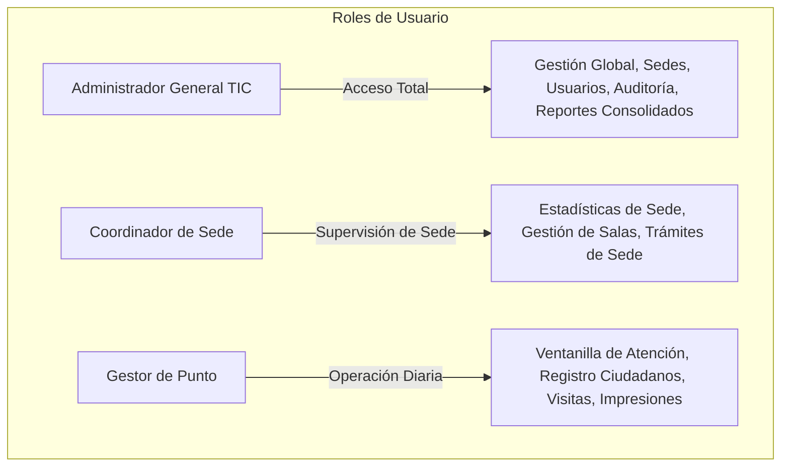

# MANUAL DE USUARIO Y OPERACIÓN PARA FUNCIONARIOS
## Plataforma de Gestión y Analítica — Puntos Vive Digital (PVD)
### Alcaldía Municipal de Acacías — Meta | Secretaría de las TIC

---

| Metadato del Documento | Detalle Institucional |
|---|---|
| **Proyecto:** | Plataforma de Registro, Gestión Comunitaria y Analítica PVD |
| **Audiencia Objetivo:** | Gestores de Sede, Coordinadores TIC, Enlaces Comunitarios |
| **Entidad:** | Alcaldía de Acacías — Meta |
| **Versión del Manual:** | 2.0.0 (Manual Oficial de Operación) |
| **Fecha de Publicación:** | Septiembre de 2026 |

---

## 1. INTRODUCCIÓN Y OBJETIVO

Bienvenido al manual oficial de operación de la **Plataforma de Gestión y Analítica de los Puntos Vive Digital (PVD)** de la Alcaldía de Acacías.

Este aplicativo web centraliza y agiliza la atención ciudadana en las salas de cómputo y aulas digitales del municipio, permitiendo llevar un control riguroso de beneficiarios, préstamos comunitarios, impresiones gratuitas y estadísticas de impacto social para la rendición de cuentas municipal.

---

## 2. ROLES Y NIVELES DE ACCESO

La plataforma cuenta con tres perfiles de usuario claramente definidos:

* **Gestor de Punto:** Opera en la sala de atención. Registra ciudadanos, visitas, préstamos de sala e impresiones de su sede.
* **Coordinador de Sede:** Supervisa la operación de un Punto Vive Digital en particular, programa los cursos y genera informes de gestión de su punto.
* **Administrador General (TIC):** Funcionario de la Secretaría de las TIC con acceso a todas las sedes, configuración del sistema, creación de usuarios y auditoría forense.

---

## 3. MÓDULO 1: ACCESO SEGURO AL SISTEMA (LOGIN)

1. Abra su navegador web (Google Chrome, Microsoft Edge o Mozilla Firefox).
2. Ingrese a la dirección oficial suministrada por la Secretaría TIC (ej. `https://pvd.acacias.gov.co` o la IP del servidor).
3. En la pantalla de inicio de sesión:
   * Digite su **Correo Electrónico Institucional** (ej: `admin@acacias.gov.co` o `gestor.plus@acacias.gov.co`).
   * Digite su **Contraseña Asignada**.
   * Haga clic en el botón verde **"Iniciar Sesión"**.

> [!TIP]
> Por seguridad institucional, la sesión se cerrará automáticamente tras 120 minutos de inactividad. No comparta sus credenciales con terceros; todas las acciones quedan asociadas a su nombre e IP en la bitácora de auditoría.

---

## 4. MÓDULO 2: PANEL DE CONTROL Y ANALÍTICA (DASHBOARD)

Al ingresar, el sistema despliega el **Dashboard Ejecutivo**, diseñado para ofrecer una visión global e instantánea del impacto del programa:

### Tarjetas de Indicadores Clave (KPIs)
* **Visitas de Hoy:** Muestra la cantidad de ciudadanos atendidos en el día corriente y el porcentaje comparativo frente al día anterior.
* **Visitas del Mes:** Acumulado total de atenciones en lo que va del mes.
* **Total Ciudadanos Registrados:** Censo consolidado del padrón municipal (más de 23.800 acacireños).
* **Hojas Impresas:** Monitoreo del consumo de insumos de impresión.
* **Préstamos de Sala:** Eventos y capacitaciones activas o programadas para el día.

### Gráficas Interactivas y Predictivas
* **Tendencia de los Últimos 7 Días:** Gráfico de barras interactivo que ilustra la afluencia diaria. La barra correspondiente al día actual aparece resaltada en verde institucional.
* **Distribución por Categorías:** Gráfico circular con el porcentaje de uso de cada servicio (Trámites de Gobierno Digital, Formación TIC, Empleo, etc.).
* **Aforo Estimado (IA):** En el panel lateral, el sistema proyecta el número estimado de visitas para el día siguiente basado en patrones históricos de demanda.

---

## 5. MÓDULO 3: DIRECTORIO DE CIUDADANOS (PADRÓN MUNICIPAL)

El directorio permite consultar y administrar la base de datos de los más de 23.800 ciudadanos empadronados.

### 5.1 Búsqueda Rápida de Ciudadanos
* En el campo superior de búsqueda, escriba el **número de documento**, el **nombre**, el **apellido** o el **barrio** del ciudadano.
* La búsqueda responde en tiempo real (menos de 10 ms) mostrando los resultados coincidentes en la tabla.

### 5.2 Registro de Nuevo Ciudadano
1. Haga clic en el botón verde **"+ Nuevo Ciudadano"**.
2. Complete la información solicitada:
   * **Tipo y Número de Documento** (Obligatorio).
   * **Nombres y Apellidos** (Obligatorio).
   * **Fecha de Nacimiento:** Al seleccionar la fecha, **el sistema calculará automáticamente la edad en años cumplidos** sin que usted deba digitarla manualmente.
   * **Género, Teléfono y Correo Electrónico.**
   * **Dirección, Barrio o Vereda y Zona** (Urbana o Rural).
   * **Estrato Socioeconómico (1 al 6).**
   * **Nivel Educativo:** Seleccione el grado de escolaridad del ciudadano (Primaria, Secundaria, Técnico, Tecnólogo, Universitario, Posgrado/Maestría).
   * **Datos de Inclusión:** Grupo Étnico, Grupo Poblacional (Madre Comunitaria, Víctima, etc.) y Tipo de Aseguramiento en Salud.
3. Haga clic en **"Guardar Ciudadano"**. El sistema validará que no exista duplicidad de documento.

### 5.3 Edición Completa de Datos (100% Modificable)
A diferencia de sistemas antiguos donde los campos quedaban bloqueados:
1. En la tabla de ciudadanos, localice a la persona y presione el botón azul **"Editar"** (ícono de lápiz).
2. Modifique **cualquiera de los campos**:
   * Si la persona culminó nuevos estudios, cambie su **Nivel Educativo** libremente.
   * Si cambió de domicilio, actualice su **Barrio**, **Dirección** o **Teléfono**.
3. Haga clic en **"Actualizar Información"**.
4. El sistema guardará los cambios y generará automáticamente un registro en la auditoría municipal con los valores previos y nuevos.

---

## 6. MÓDULO 4: REGISTRO DE ATENCIONES Y VISITAS

Este es el módulo de mayor uso operativo en la ventanilla de entrada del Punto Vive Digital.

### Flujo de Registro Rápido:
1. Haga clic en **"Registrar Visita"** en el menú lateral o en el botón de acceso rápido del Dashboard.
2. Ingrese el **Número de Documento** del ciudadano:
   * **Si el ciudadano ya existe:** El sistema autocompletará instantáneamente sus nombres, apellidos, edad y nivel educativo.
   * **Si es un ciudadano nuevo:** El sistema desplegará los campos básicos para que los ingrese allí mismo. Al guardar la visita, **se creará automáticamente el ciudadano en la base de datos sin salir de la pantalla** (Transacción Atómica).
3. Seleccione la **Sede PVD** donde se encuentra.
4. Seleccione la **Categoría del Servicio** (ej: *Trámites Ciudadanos en Línea*, *Capacitación*, *Internet y Sala Libre*).
5. Seleccione la **Subcategoría** correspondiente.
6. Indique la **Duración Estimada** en minutos (por defecto 30 minutos).
7. (Opcional) Digite una breve observación o descripción en caso de trámites especiales.
8. Haga clic en **"Confirmar Visita"**. El sistema registrará la atención y la sumará de inmediato a las métricas del día.

---

## 7. MÓDULO 5: PRÉSTAMO DE SALAS Y ESPACIOS COMUNITARIOS

Diseñado para la reserva de aulas de cómputo y auditorios de los PVD.

### 11 Nuevas Categorías Reales de Actividad Comunitaria
Los préstamos ya no se registran como "otro", sino asignados a su propósito comunitario real:
1. **Convenios Formativos y Cursos SENA / Alcaldía:** Clases del SENA, manipulación de alimentos, contabilidad, etc.
2. **Instituciones Educativas y Colegios:** Clases de informática de colegios públicos y privados.
3. **ICBF y Programas de Niñez:** Talleres de primera infancia y madres comunitarias.
4. **Juntas de Acción Comunal (JAC):** Asambleas barriales y reuniones directivas comunitarias.
5. **Cine Comunitario y Proyecciones:** Tardes de cineclub infantil y juvenil.
6. **Programas Sociales, Paz y Fundaciones:** Talleres con víctimas, ARN, adultos mayores.
7. **Expresiones Culturales, Arte y Danza:** Grupos culturales, torneos de ajedrez digital.
8. **Jornadas de Salud y Brigadas:** Vacunación, afiliaciones a salud, tamizajes.
9. **Emprendimiento, Comercio Local y Empleo:** Ruedas de empleo, ferias microempresariales.
10. **Reuniones Institucionales de la Alcaldía:** Dependencias municipales y gobernación.
11. **Otras Actividades Comunitarias.**

### Cómo Registrar un Préstamo de Sala:
1. Vaya a la sección **"Préstamo de Salas"** y haga clic en **"+ Nueva Reserva"**.
2. Indique el **Nombre del Responsable o Entidad Solicitante** (ej: *Carlos Ríos - Instructor SENA*).
3. Seleccione la **Sede PVD** solicitada.
4. Elija la **Categoría de Actividad** dentro de las 11 opciones normalizadas.
5. Indique el **Número de Asistentes Proyectados**.
6. Defina la **Fecha**, **Hora de Inicio** y **Hora de Fin**.
7. Ingrese el detalle u observaciones del evento.
8. Haga clic en **"Crear Reserva"**.

---

## 8. MÓDULO 6: REGISTRO DE IMPRESIONES COMUNITARIAS

Permite llevar el balance exacto de insumos de impresión (papel y tóner):
1. Ingrese al módulo **"Impresiones"** y haga clic en **"Registrar Impresión"**.
2. Digite la cédula del ciudadano beneficiario.
3. Indique el **Número de Hojas** impresas.
4. Seleccione el **Tipo de Trámite** (Cédula de ciudadanía, certificado Sisbén, hoja de vida, etc.).
5. Haga clic en **"Guardar"**. El contador de folios de la sede se actualizará automáticamente.

---

## 9. MÓDULO 7: GENERADOR DE REPORTES Y EXPORTACIÓN PARAMETRIZADA

Para auditorías, comités de empalme o rendición de cuentas, la plataforma permite generar reportes personalizados:

### Pasos para Exportar a Excel (.xlsx) o CSV:
1. Diríjase a la sección **"Reportes"**.
2. Seleccione el tipo de reporte: **Visitas**, **Ciudadanos**, **Préstamos de Sala** o **Impresiones**.
3. Aplique los **Filtros Deseados**:
   * Rango de fechas (*Fecha Desde* y *Fecha Hasta*).
   * Sede PVD específica o todas las sedes.
   * Categoría de trámite.
4. **Personalización de Columnas:** Marque únicamente las casillas de los datos que requiere incluir en su reporte (ej: Cédula, Nombres, Nivel Educativo, Barrio, Categoría, Fecha).
5. Seleccione el formato de salida:
   * **Excel (.xlsx):** Genera una hoja de cálculo con diseño institucional verde y dorado, inmovilización de paneles y autoajuste de ancho de columnas.
   * **CSV (UTF-8):** Ideal para procesar millones de registros en Microsoft Power BI, Python o software de Big Data.
6. Presione el botón **"Descargar Reporte"**. El archivo se descargará directamente en su computadora.

---

## 10. PREGUNTAS FRECUENTES (FAQ) Y SOPORTE TÉCNICO

* **¿Qué hago si un ciudadano dice que sus datos están mal escritos?**
  Vaya a *Ciudadanos*, busque la cédula, haga clic en *Editar*, corrija los nombres, teléfono o nivel educativo y guarde los cambios.
* **¿Qué pasa si se va el internet en la sede?**
  La plataforma opera sobre el VPS privado centralizado. Una vez se restablezca la conectividad en la sede, podrá ingresar las atenciones pendientes con su fecha y hora correspondientes.
* **¿Dónde reporto una falla o solicito un nuevo usuario?**
  Comuníquese directamente con la Oficina de Tecnologías de la Información y las Comunicaciones (TIC) de la Alcaldía de Acacías al correo: `tic@acacias.gov.co`.
