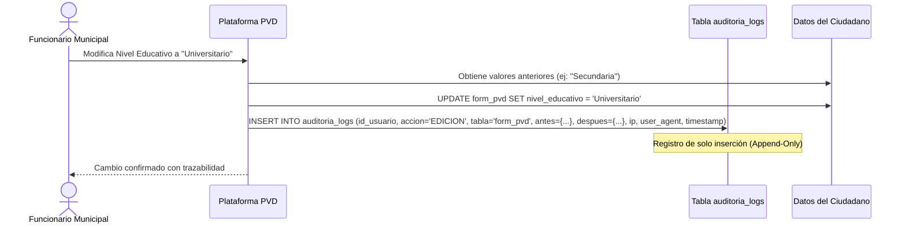

# PROTOCOLO DE SEGURIDAD DE LA INFORMACIÓN, PROTECCIÓN DE DATOS (HABEAS DATA) Y AUDITORÍA FORENSE
## Plataforma de Gestión y Analítica — Puntos Vive Digital (PVD)
### Alcaldía Municipal de Acacías — Meta | Secretaría de las TIC

---

| Metadato del Documento | Detalle Institucional |
|---|---|
| **Proyecto:** | Plataforma de Registro, Gestión Comunitaria y Analítica PVD |
| **Entidad Reguladora:** | Alcaldía de Acacías — Meta |
| **Marco Jurídico:** | Ley Estatutaria 1581 de 2012 / Decreto 1377 de 2013 / Guía MinTIC |
| **Clasificación:** | Seguridad de la Información — Cumplimiento Legal Estricto |
| **Versión:** | 2.0.0 (Protocolo Oficial de Seguridad y Privacidad) |
| **Fecha de Publicación:** | Septiembre de 2026 |

---

## 1. MARCO NORMATIVO Y CUMPLIMIENTO LEGAL (COLOMBIA)

La plataforma de los Puntos Vive Digital de la Alcaldía de Acacías administra información de carácter personal de más de **23.800 acacireños**. En consecuencia, su diseño y operación están sujetos al cumplimiento de la legislación colombiana sobre tratamiento de datos personales:

1. **Ley Estatutaria 1581 de 2012:** Disposiciones generales para la protección de datos personales (*Régimen General de Habeas Data*).
2. **Decreto 1377 de 2013:** Reglamentación del aviso de privacidad, autorización del titular y deberes de los responsables y encargados del tratamiento.
3. **Ley 1712 de 2014:** Ley de Transparencia y del Derecho de Acceso a la Información Pública Nacional.
4. **Lineamientos de Seguridad y Privacidad de la Información (MinTIC - Modelo MSPI):** Estándar del Gobierno Digital de Colombia.

---

## 2. PRINCIPIOS RECTORES APLICADOS AL PADRÓN CIUDADANO

* **Principio de Finalidad:** La recolección de variables demográficas (`edad`, `nivel_educativo`, `barrio`, `estrato`, `grupo_etnico`) tiene como única finalidad la focalización de programas de alfabetización digital y la rendición de cuentas del Plan de Desarrollo Municipal.
* **Principio de Veracidad o Calidad:** La información debe ser veraz, completa y exacta. Por esta razón, el sistema garantiza que los ciudadanos puedan **actualizar y rectificar el 100% de sus variables demográficas** en cualquier momento que asistan a un PVD.
* **Principio de Acceso y Circulación Restringida:** Los datos de contacto personal (teléfono, correo y dirección) están protegidos y no son públicos en internet. Solo el personal institucional autenticado tiene acceso según su nivel de autorización.

---

## 3. MATRIZ DE CONTROL DE ACCESO BASADO EN ROLES (RBAC)

El principio de menor privilegio (*Principle of Least Privilege - PoLP*) rige la asignación de permisos en la plataforma:

| Módulo / Acción en el Sistema | Gestor de Punto | Coordinador de Sede | Administrador General TIC | Auditor / Control Interno |
|---|:---:|:---:|:---:|:---:|
| **Consultar Padrón de Ciudadanos** | Solo consulta/búsqueda | Consulta total | Consulta total | Solo lectura |
| **Registrar Nuevo Ciudadano** | ✅ Permitido | ✅ Permitido | ✅ Permitido | ❌ Denegado |
| **Editar Ciudadano (`nivel_educativo`, etc.)** | ✅ Permitido | ✅ Permitido | ✅ Permitido | ❌ Denegado |
| **Registrar Visitas y Atenciones** | ✅ Sede asignada | ✅ Sede asignada | ✅ Todas las sedes | ❌ Denegado |
| **Gestionar Préstamos de Sala** | ✅ Sede asignada | ✅ Sede asignada | ✅ Todas las sedes | ❌ Denegado |
| **Registrar Consumo de Impresiones**| ✅ Sede asignada | ✅ Sede asignada | ✅ Todas las sedes | ❌ Denegado |
| **Exportar Reportes a Excel / CSV** | ✅ Sede asignada | ✅ Sede asignada | ✅ Todas las sedes | ✅ Consulta general |
| **Crear / Desactivar Funcionarios** | ❌ Denegado | ❌ Denegado | ✅ Exclusivo TIC | ❌ Denegado |
| **Configuración de Sedes PVD** | ❌ Denegado | ❌ Denegado | ✅ Exclusivo TIC | ❌ Denegado |
| **Ver Bitácora de Auditoría Forense**| ❌ Denegado | ❌ Denegado | ✅ Acceso completo | ✅ Solo lectura |

---

## 4. MEDIDAS TÉCNICAS DE SEGURIDAD Y DEFENSA EN PROFUNDIDAD

### 4.1 Criptografía y Protección de Credenciales
* **Almacenamiento de Contraseñas:** Las claves de acceso de los funcionarios se transforman en hashes unidireccionales mediante el algoritmo **Bcrypt** con costo de cálculo adaptativo (cost factor 12). Es computacionalmente inviable revertir el hash a la contraseña original, incluso en caso de acceso no autorizado al archivo de la base de datos.
* **Protección de Sesión:**
  * Al autenticarse, el framework regenera automáticamente el identificador de sesión para neutralizar ataques de fijación de sesión (*Session Fixation*).
  * Las cookies de sesión poseen las banderas `HttpOnly` (inmunes a robos mediante JavaScript en el navegador) y `SameSite=Lax` (prevención de ataques CSRF).

### 4.2 Blindaje contra Amenazas Web OWASP Top 10

#### A. Prevención de Inyección SQL (SQLi)
* Ninguna consulta a la base de datos concatena cadenas de texto ingresadas por el usuario.
* Todas las operaciones utilizan **PDO con Prepared Statements** o el ORM Eloquent, separando estrictamente la instrucción SQL de los datos.

#### B. Prevención de Cross-Site Scripting (XSS)
* Todo dato dinámico renderizado en la interfaz mediante React 18 / JSX utiliza codificación y escape contextual automático en el Virtual DOM (neutralizando caracteres peligrosos `<`, `>`, `&`, `"`, `'`), eliminando vectores de inyección XSS reflejado o almacenado, y manteniendo un shell seguro de arranque con Inertia.js.

#### C. Prevención de Cross-Site Request Forgery (CSRF)
* Cada formulario HTML y petición AJAX mutante (`POST`, `PUT`, `DELETE`) exige un token criptográfico generado por el servidor (`@csrf`), impidiendo que sitios externos emulen solicitudes en nombre de un funcionario con sesión abierta.

#### D. Límite de Tasa de Peticiones (Rate Limiting / Anti-Brute Force)
* La ruta de autenticación (`/login`) cuenta con un acelerador (*Throttle Middleware*) que bloquea temporalmente la dirección IP tras 5 intentos fallidos consecutivos durante 60 segundos.

---

## 5. SISTEMA DE AUDITORÍA FORENSE INMUTABLE (`auditoria_logs`)

Para garantizar la rendición de cuentas ante la Contraloría, Procuraduría y la Oficina de Control Interno Disciplinario, cada alteración significativa en el sistema genera una pista de auditoría inmutable:

### Estructura de la Pista de Auditoría:
* **`id_usuario`:** Identificador del funcionario que ejecutó la acción.
* **`accion`:** Tipo de operación realizada (`LOGIN`, `CREACION`, `EDICION`, `ELIMINACION`, `EXPORT`).
* **`tabla`:** Entidad modificada (`form_pvd`, `visitas`, `prestamo_sala`, etc.).
* **`id_registro`:** Clave primaria del registro alterado.
* **`datos_anteriores`:** Snapshot en formato JSON con los valores que tenía el registro antes del cambio.
* **`datos_nuevos`:** Snapshot en formato JSON con los valores que asumió el registro tras el cambio.
* **`ip_origen`:** Dirección IP pública o privada desde donde se originó la petición.
* **`user_agent`:** Navegador web y sistema operativo del equipo cliente.
* **`created_at`:** Marca de tiempo exacta con precisión de segundo.

---

## 6. PROTOCOLO DE RESPUESTA ANTE INCIDENTES DE SEGURIDAD

En caso de detectarse un evento sospechoso o brecha de seguridad:
1. **Detección y Aislamiento Inmediato:** El Administrador TIC puede revocar de inmediato las sesiones activas y desactivar la cuenta del usuario comprometido desde el panel administrativo (`activo = 0`).
2. **Análisis Forense:** Se consulta la tabla `auditoria_logs` filtrando por la dirección IP y el rango horario del incidente para determinar el alcance exacto de la información accedida o modificada.
3. **Restauración de Integridad:** De ser necesario, se revierten los cambios utilizando los snapshots JSON de `datos_anteriores` o se restaura el backup en caliente de la base de datos.
4. **Notificación Institucional:** La Oficina de las TIC emite el reporte oficial a la Dirección de Control Interno y a la Superintendencia de Industria y Comercio (SIC) dentro de los plazos fijados por la Ley 1581 de 2012.
