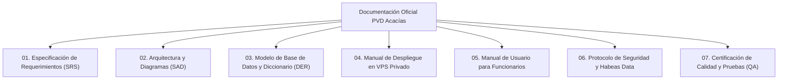

# PAQUETE DE DOCUMENTACIÓN TÉCNICA Y OPERATIVA OFICIAL — SIVID
## SIVID: Sistema de Información Vive Digital
### Alcaldía Municipal de Acacías — Meta | Secretaría de las TIC

---

| Metadato Institucional | Detalle de la Entrega |
|---|---|
| **Nombre Oficial del Sistema:** | **SIVID** (Sistema de Información Vive Digital) |
| **Entidad Propietaria:** | Alcaldía de Acacías — Nit: 892.099.169-4 |
| **Dependencia:** | Oficina de Tecnologías de la Información y las Comunicaciones (TIC) |
| **Versión de Entrega:** | 2.0.0 (Producción / Despliegue en VPS Privado) |
| **Fecha:** | Septiembre de 2026 |

---

## 📚 ÍNDICE MAESTRO DE DOCUMENTOS DISPONIBLES

Este repositorio contiene la suite completa de ingeniería de software requerida para la recepción, auditoría, operación y mantenimiento de la plataforma por parte de los funcionarios e ingenieros de la Alcaldía de Acacías:

---

### 📄 Relación y Propósito de Cada Documento

1. **[01. Especificación de Requerimientos de Software (SRS)](01_especificaciones_requerimientos_srs.md)**
   * **Estándar:** IEEE Std 830-1998 / ISO/IEC/IEEE 29148.
   * **Contenido:** Ficha técnica, alcance del proyecto, roles de usuario, 15 requerimientos funcionales (RF-01 a RF-15), 12 requerimientos no funcionales bajo ISO/IEC 25010 y reglas de negocio municipales.
   * **Dirigido a:** Supervisores de contrato, auditores, ingenieros de sistemas.

2. **[02. Arquitectura de Software y Diagramas de Diseño (SAD)](02_arquitectura_diagramas_diseno.md)**
   * **Estándar:** Modelo C4 y UML 2.5.
   * **Contenido:** Arquitectura lógica por capas (MVC + Service Layer), Diagrama de Clases UML, Diagrama de Casos de Uso, Diagramas de Secuencia transaccionales (registro atómico de visitas y exportación de reportes).
   * **Dirigido a:** Desarrolladores, arquitectos de software, administradores de plataforma.

3. **[03. Modelo y Diccionario de Base de Datos (DER)](03_modelo_base_datos_diccionario.md)**
   * **Contenido:** Diagrama Entidad-Relación (Mermaid), Diccionario de datos de las 12 tablas (`form_pvd`, `visitas`, `prestamo_sala`, `registro_impresion`, etc.), tipos de datos, claves primarias y foráneas, restricciones, y estrategia de índices B-Tree de alto rendimiento.
   * **Dirigido a:** Administradores de bases de datos (DBA), analistas de datos.

4. **[04. Manual de Despliegue y Mantenimiento en VPS Privado](04_manual_despliegue_vps_alcaldia.md)**
   * **Contenido:** Requisitos de hardware del VPS, aprovisionamiento paso a paso en Ubuntu Server (Nginx, PHP 8.2-FPM, extensiones), configuración de VirtualHost con SSL, permisos de Linux, tareas programadas (cron), scripts de backup diario en caliente y Plan de Recuperación ante Desastres (DRP).
   * **Dirigido a:** Administradores de infraestructura, ingenieros DevOps/Sysadmin de la Alcaldía.

5. **[05. Manual de Usuario y Operación para Funcionarios](05_manual_usuario_funcionarios.md)**
   * **Contenido:** Guía didáctica paso a paso para gestores y coordinadores: acceso seguro, uso del Dashboard analítico, búsqueda y registro de ciudadanos con auto-cálculo de edad, **edición 100% libre de variables sociodemográficas (Nivel Educativo, etc.)**, reserva de salas con las 11 nuevas categorías, control de impresiones y exportación personalizada a Excel y CSV.
   * **Dirigido a:** Gestores de Punto Vive Digital, coordinadores de sede, funcionarios de ventanilla.

6. **[06. Protocolo de Seguridad, Habeas Data y Auditoría Forense](06_seguridad_habeas_data_auditoria.md)**
   * **Marco Legal:** Ley Estatutaria 1581 de 2012 y Decreto 1377 de 2013 (Colombia).
   * **Contenido:** Principios rectores aplicados al padrón de 23.800 ciudadanos, matriz de control de acceso basada en roles (RBAC), mecanismos criptográficos (Bcrypt, tokens CSRF, protección XSS/SQLi), y funcionamiento de la bitácora inmutable de auditoría forense (`auditoria_logs`).
   * **Dirigido a:** Oficial de Protección de Datos Personales, Control Interno Disciplinario, Oficina Jurídica.

7. **[07. Certificación de Calidad de Software, Pruebas y Benchmark (QA)](07_certificacion_calidad_qa.md)**
   * **Contenido:** Informe de ejecución de la suite automatizada de 16 pruebas (100% PASS), tiempos de latencia (Dashboard a 40 ms, búsqueda a 5.7 ms), pruebas de estrés con 16.909 ops/seg, verificación de integridad ACID y acta formal de entrega técnica.
   * **Dirigido a:** Comité técnico evaluador, Secretaría de las TIC, interventoría.
